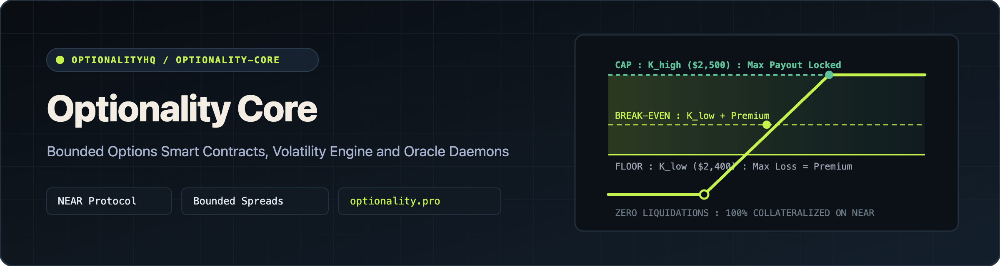
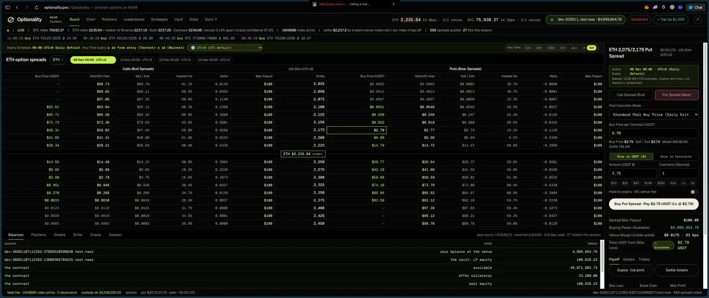
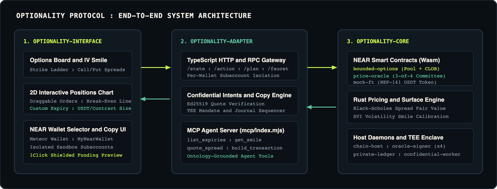
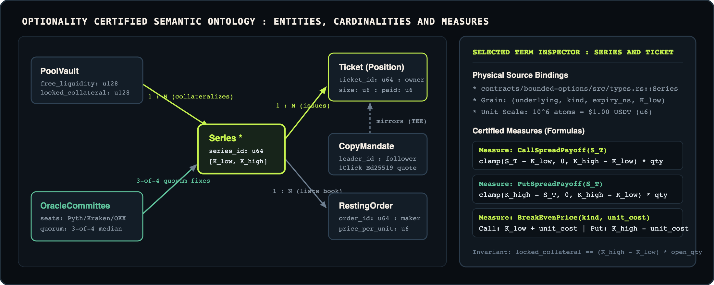

 

**Bounded Options on NEAR Protocol: Zero Liquidations, 100% Escrowed Collateral, 3-of-4 Committee Oracle and Confidential Copy Trading**

[Launch Terminal](https://optionality.pro) · [Developer Docs](https://optionality.pro/docs) · [`OptionalityHQ/optionality-core`](https://github.com/OptionalityHQ/optionality-core) · [`OptionalityHQ/optionality-interface`](https://github.com/OptionalityHQ/optionality-interface) · [`OptionalityHQ/optionality-adapter`](https://github.com/OptionalityHQ/optionality-adapter)

---

## Why Optionality?

Perpetual futures liquidate traders on temporary wicks before their thesis plays out, while naked options expose liquidity providers to unbounded tail risk. **Optionality** structures every option as a **bounded vertical spread** $[K_{\text{low}}, K_{\text{high}}]$ on NEAR:

1. **No Liquidations**: A buyer's maximum loss is strictly the upfront USDT premium paid.
2. **100% Solvency by Construction**: Because the maximum payout per contract is $W = K_{\text{high}} - K_{\text{low}}$, the smart contract locks 100% of $W \times q$ in NEP-141 USDT at trade inception.
3. **Hybrid Pool + CLOB Execution**: Trade immediately against the Black-Scholes LP Pool Vault or rest/match limit orders on the on-chain Central Limit Order Book.
4. **3-of-4 Independent Oracle Committee**: Four isolated signer processes (**Pyth**, **Kraken**, **OKX**, **Venue Index**) sign expiry prints; settlement requires a 3-of-4 median quorum.
5. **Confidential 1Click/Intents Copy Trading**: Follow top strategy leaders with Ed25519-verified shielded funding and zero-front-running TEE mandate sequencing.

  

  

---

## Repositories

| Repository | Tech Stack | Role and Contents | Verification Suite |
| :--- | :--- | :--- | :--- |
| **[`OptionalityHQ/optionality-core`](https://github.com/OptionalityHQ/optionality-core)** | Rust, `near-sdk` 5.x, Tokio | Smart contracts (`bounded-options`, `price-oracle`, `mock-ft`), Black-Scholes and SVI volatility engine (`:8787`), TEE `private-ledger`, and `chain-host` / `oracle-signer` daemons. | `280+` Rust unit and integration tests |
| **[`OptionalityHQ/optionality-interface`](https://github.com/OptionalityHQ/optionality-interface)** | TypeScript, HTML5 Canvas, NEAR Wallet Selector | Web trading terminal (`Board`, `Positions`, `Strategies`, `Leaderboard`), 2D draggable positions chart with Break-Even lines, and Playwright E2E suite. | `14/14` unit tests + browser E2E suite |
| **[`OptionalityHQ/optionality-adapter`](https://github.com/OptionalityHQ/optionality-adapter)** | TypeScript ESM, `near-api-js`, 1Click SDK, MCP | HTTP/RPC gateway (`:8790`), per-wallet subaccount isolation, 1Click/Intents Ed25519 verifier, copy-trading service, MCP agent server, and protocol docs. | `96/96` gateway, chain and Intents tests |

---

## Source-Grounded Domain Ontology

  

See [`OptionalityHQ/optionality-core/docs/ONTOLOGY.md`](https://github.com/OptionalityHQ/optionality-core/blob/main/docs/ONTOLOGY.md) for the full Question Contracts, Entity Terms, Relationship Cardinalities, and Certified Mathematical Measures.
